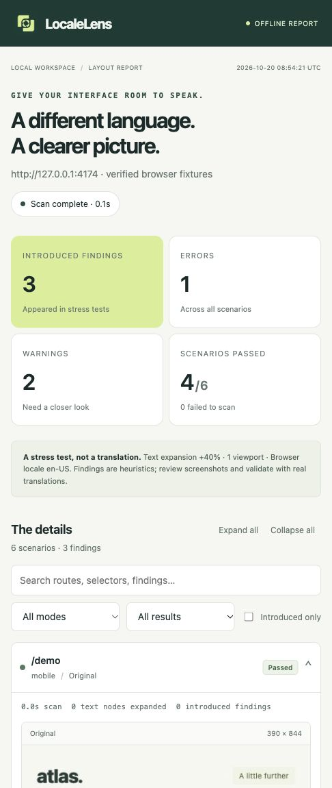

<p align="center">
  
</p>

# LocaleLens

**Catch broken layouts before translating your app.**

LocaleLens stress-tests a website with longer text and right-to-left layouts, then shows you what broke. Start scans from a local web panel or the CLI, revisit your SQLite history, and share self-contained HTML reports. No domain, hosted backend, account, telemetry, or AI API key required.

Created and maintained by [@sikeat7](https://github.com/sikeat7). [Sponsor this project](#sponsor).

[Download the PNG logo](docs/assets/localelens-logo.png) · [Brand assets](docs/branding.md)



## What it checks

- **Horizontal overflow:** elements that extend beyond the viewport.
- **Likely text clipping:** text cut off by fixed-size containers.
- **JavaScript exceptions:** uncaught page errors encountered during the scan.
- **Introduced vs. existing issues:** compare each stress scenario with the same route and viewport in its original layout.

Try normal, expanded-text, RTL, and combined expanded + RTL modes. Desktop, mobile, tablet, and custom viewport sizes are supported. Screenshots include numbered findings; reports include selectors, text snippets, and suggested fixes.

Open **How to fix this** under a report finding for inspection steps, CSS/JavaScript/configuration examples, a copy-code button, and a verification checklist. RTL layout findings include direction-aware CSS guidance. These are patterns to adapt to your component, not generated patches to your source. See [fixing findings](docs/fixing-findings.md).

**This is a layout stress test, not a translation service.** It does not establish linguistic correctness, complete RTL support, accessibility compliance, or the absence of layout bugs. See [limitations](docs/limitations.md).

## Open the web panel

**The web panel is unreleased.** The `v0.1.0-rc.1` GitHub release contains the CLI only. Use a source checkout that includes `web/`, `src/panel.ts`, and the `start` script in `package.json` for the instructions below.

### First-time setup

Install **Node.js 22.13 or later**, including npm, from [nodejs.org](https://nodejs.org/). Run these commands in your computer's normal Terminal, PowerShell, or Command Prompt:

```sh
git clone https://github.com/sikeat7/LocaleLens.git
cd LocaleLens
node --version
npm ci --include=dev
npm run browser:install
npm start
```

If you downloaded **Code → Download ZIP** instead, extract the archive and open a terminal inside the extracted folder, where `package.json` is located. Start with `node --version` in the commands above; you do not need Git or the first two commands.

On Linux, replace the browser installation step with `npx playwright install --with-deps chromium` to install the required system libraries as well. That step may ask for your system administrator password.

The first setup needs internet access. `npm ci --include=dev` installs the compiler needed to build from source, even if your environment normally omits development dependencies. The browser installation downloads the Chromium version matched to this project; having Chrome installed is not enough.

When the terminal prints `LocaleLens workspace: http://127.0.0.1:4175`, open that address if your browser did not open automatically. **Keep this terminal open while using the panel.** Enter `design.google`, select **Quick look**, and click **Start scan**. Use **View report** after the scan finishes.

No `www`, `http://`, or `https://` prefix is required. Public domains default to HTTPS; localhost and loopback addresses default to HTTP. Full URLs still work. Existing `www` hostnames are preserved, and normal redirects to a site's `www` counterpart or HTTPS are accepted.

If Cloudflare presents a security verification page, LocaleLens reports **Access blocked** instead of testing that page's layout. It stops active checks and skips all remaining routes, devices, and modes without retries or challenge screenshots. For a site you control, use a local build or an approved staging environment; the scanner does not solve or bypass verification. See [access challenges](docs/web-panel.md#protected-websites).

### Subsequent starts

From the same project folder, run:

```sh
npm start
```

Or use the platform launcher from your source checkout:

- **macOS:** double-click `Start-LocaleLens.command`.
- **Windows:** double-click `Start-LocaleLens.bat`.
- **Linux:** run `npm start` in the project folder.

The launchers can also prepare a fresh source checkout if Node.js and npm are already installed: they install dependencies when `node_modules` is absent, ensure Chromium is installed, build, and open the panel. If a downloaded macOS launcher cannot execute, use the terminal instructions above. After updating the source or switching branches, rerun `npm ci --include=dev` and `npm run browser:install` before starting; the launchers do not repair stale dependencies automatically.

Press **Ctrl+C** in its terminal to stop the panel. Your saved history remains available on the next start. Scans need access to the website being tested.

### What you can do

- Follow live progress and queue additional scans.
- Watch the live pipeline from queue through browser startup, scenario checks, and report saving, with timestamps and the current page/device/mode.
- Search and filter previous scans; settings, progress, and results survive restarts.
- Open saved reports, download JSON, or rerun a scan with the same settings.
- Cancel active scans and delete old history with its report files.
- Adjust devices, text growth, page paths, locale, readiness, ignores, and screenshot masks.

History lives in `~/.localelens/history.sqlite`; reports are stored alongside it. The panel accepts connections only from this computer and is intended for a single local user. See the [web panel guide](docs/web-panel.md) and [local API contract](docs/panel-api.md).

### Trouble starting?

| What you see                                                              | What to do                                                                                                                                                                                        |
| ------------------------------------------------------------------------- | ------------------------------------------------------------------------------------------------------------------------------------------------------------------------------------------------- |
| `node` or `npm` is not recognized                                         | Install Node.js with npm, reopen your terminal, and check `node --version` and `npm --version`.                                                                                                   |
| `Missing script: start`                                                   | You have a version without the web panel. The `v0.1.0-rc.1` release supports the CLI only. Check that your source includes the panel files described above.                                       |
| npm cannot find `package.json`                                            | Change into the extracted/cloned LocaleLens folder before running the commands.                                                                                                                   |
| `tsc` is missing or the build fails after updating                        | Run `npm ci --include=dev`, then `npm start`.                                                                                                                                                     |
| Chromium's executable is missing                                          | Run `npm run browser:install` in this project folder. On Linux, use the `--with-deps` command above.                                                                                              |
| `macOS denied browser startup` / `bootstrap_check_in … Permission denied` | Stop the panel started by an agent or restricted runner, then start it in your normal Terminal. This restriction occurs before any website is scanned; reinstalling Chromium does not resolve it. |
| Port 4175 is already in use                                               | Close the other panel, or run `node dist/cli.js serve --open --port 4180` after building.                                                                                                         |
| Another panel owns the data directory                                     | Close the existing panel before starting a second one with the same history.                                                                                                                      |

To keep history from a session started with a custom data directory, use that same directory again, for example `node dist/cli.js serve --open --data-dir ./work/panel-data`. Starting with the default directory does not import a different session's history.

## Use the CLI

Requires **Node.js 22.13 or later** and an application URL to inspect.

```sh
npm ci --include=dev
npm run build
npm run browser:install
node dist/cli.js scan http://localhost:3000
```

Open `localelens-report/index.html` in your browser. The HTML embeds its screenshots and works offline; you can share that single file. Structured results are saved in `localelens-report/report.json`.

To install the command locally after building:

```sh
npm link
localelens scan http://localhost:3000
```

The GitHub prerelease includes a CLI tarball. The package has not been published to the npm registry; the source instructions above do not require a registry release.

## See it catch a bug

Start the included fictional travel website:

```sh
npm run demo
```

In another terminal:

```sh
node dist/cli.js scan http://127.0.0.1:4173 \
  --routes /,/healthy \
  --modes baseline,expanded,rtl,expanded-rtl \
  --fail-on warning
```

The `/` page deliberately uses fragile fixed-width labels and a physical left offset. `/healthy` uses a more flexible layout. A nonzero exit code is expected when scanning the broken version.

## Make it fit your app

```sh
node dist/cli.js init
```

Edit `localelens.config.json`:

```json
{
  "url": "http://localhost:3000",
  "routes": ["/", "/pricing"],
  "modes": ["baseline", "expanded", "rtl", "expanded-rtl"],
  "viewports": ["desktop", "mobile"],
  "expansion": 40,
  "waitFor": "main",
  "ignore": [".carousel"],
  "mask": [".customer-email"],
  "output": "localelens-report",
  "failOn": "warning"
}
```

```sh
node dist/cli.js scan
```

Use `data-localelens-ignore` on an intentionally unusual layout region, or pass `--ignore '.selector'`. Ignored regions are still visible in screenshots; use `--mask` for sensitive content. Masks exclude matching subtrees from text snippets and cover them in screenshots. Masks do not sanitize URLs or application exception messages.

For authentication, readiness settings, custom viewports, JSON output, and all options, see the [configuration guide](docs/configuration.md). A [JSON Schema](localelens.schema.json) is included for editor completion.

## Use it in CI

```sh
npx playwright install --with-deps chromium
node dist/cli.js scan http://127.0.0.1:3000 --fail-on warning
```

Start your application and wait until it is ready before scanning. Preserve the report as a CI artifact even if checks fail. See the [GitHub Actions example](docs/ci.md).

| Exit code | Meaning                                                            |
| --------- | ------------------------------------------------------------------ |
| `0`       | No findings at the configured failure threshold                    |
| `1`       | Findings meet the threshold, or the finding limit was exceeded     |
| `2`       | Invalid configuration, browser failure, failed scan, or HTTP error |
| `130`     | Interrupted                                                        |

Default `--fail-on error` fails on overflow. Use `--fail-on warning` to also fail on clipping and JavaScript exceptions. `--fail-on none` allows findings but still fails when a page could not be scanned.

## Privacy and repeatability

LocaleLens has no telemetry or external analysis service. The inspected website still makes its normal network requests; scanning is **not** network isolation. Reports may contain page content, URLs, exception messages, and screenshots. Review them before sharing.

Each scenario uses a fresh browser context. Motion is disabled, fonts are awaited within the time budget, and screenshot size is bounded. Run comparisons on the same OS and browser build for consistent rendering. Authentication files are not embedded in reports and should never be committed.

## Development

```sh
npm ci
npm run browser:install
npm run check
npm pack --dry-run
```

The tests launch real Chromium against local fixtures. They cover clean and broken layouts, baseline comparisons, masks and ignores, offline report interactions, authentication, errors, cancellation, and CLI exit codes.

In restricted desktop environments, `npm run test:unit` runs checks that do not launch a browser, including the local HTTP API and SQLite lifecycle. `npm run test:panel` runs just the panel API tests with a deterministic scan executor. `npm run test:browser-ui` starts supplementary DOM checks at `http://127.0.0.1:4174`; open that page and click **Run browser checks**. This supplements the full Chromium integration suite and does not replace it. See the [initial verification record](docs/verification.md) for the checks completed during this build.

See [CONTRIBUTING.md](CONTRIBUTING.md), [SECURITY.md](SECURITY.md), and the [release guide](docs/releasing.md). LocaleLens is available under the [MIT license](LICENSE).

## Sponsor

If LocaleLens saves you time, consider supporting its ongoing maintenance and development.

[**Sponsor @sikeat7 on GitHub**](https://github.com/sponsors/sikeat7)

You can also support the project by starring the repository, reporting reproducible bugs, sharing LocaleLens, or contributing improvements.
